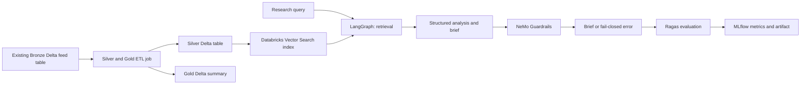

#  Autonomous Market Intelligence Engine

AMI Engine is an experimental, production-oriented portfolio project for evidence-grounded market research. Its current implementation has one LangGraph runtime, Databricks Vector Search retrieval, structured LLM output, a fail-closed NeMo Guardrails check, a Bronze-to-Silver/Gold Databricks job, and Ragas evaluation recorded in MLflow.

“Production-oriented” describes the engineering direction and safeguards in code. This repository has **not** been qualified as production-ready: a mock smoke case and a six-case external-filing pilot completed on October 15, 2026, but broad market-intelligence evaluation and external deployment have not been verified. Do not use it for business-critical decisions until your workspace deployment, security, recovery, monitoring, and evaluation controls pass the operational checklist below.

## Architecture



The checked-in ETL task starts from an existing Bronze table; ingestion from external news, SEC, or market feeds is not included. The vector index and workspace endpoints must already exist or be created by the sync task. The graph uses one canonical `MarketState` in `src/agents/graph.py` and will not generate an answer when retrieval is empty.

## Implemented components

| Component | Implementation | External requirement / current boundary |
|---|---|---|
| LangGraph agent | Retrieval → structured analysis/brief → guardrails. | Supports local BM25 or dense retrieval over exported JSON, or Databricks Vector Search. Generation uses the configured Ollama, Groq, or OpenAI model. |
| Databricks data | `src/etl/silver_ingestion.py` validates an existing Bronze schema and refreshes Silver and Gold Delta tables. | Bronze source population, Unity Catalog grants, and compute are workspace responsibilities. |
| Vector Search | `src/indexers/vector_search_sync.py` creates or syncs a Delta Sync index using the current `databricks-ai-search` client. | Requires an existing Silver Delta table and a Databricks Vector Search endpoint. |
| Guardrails | Runtime graph calls the NeMo wrapper and fails closed on exception or rejection. | The configured rails require end-to-end adversarial and grounding validation in the target workspace; this review did not prove their semantic effectiveness. |
| Evaluation | `src/evals/run_ragas.py` computes Faithfulness, Answer Relevancy, Context Precision, and Context Recall from graph outputs. | One mock smoke case and a six-case external-filing pilot completed; no broad market-intelligence benchmark is claimed. Missing answers, contexts, or metrics abort the evaluation. |
| Tracking | Evaluation means, per-example CSV, dataset/model metadata, and elapsed time are logged to MLflow. | Local file tracking is the default unless `MLFLOW_TRACKING_URI` is configured. |
| Serving | Unity Catalog registration and endpoint scripts remain separate deployment utilities. | Endpoint deployment has not been verified. It requires a registered model version and workspace identity. |
| Automation | GitHub Actions runs unit tests on pushes to `main` and pull requests. | It intentionally does not run paid/live Databricks or model evaluations. |

## Configuration

Use Python 3.12.10 for local runs. Install the pinned direct dependencies and create a local environment file:

```powershell
py -3.12 -m venv .venv
.\.venv\Scripts\Activate.ps1
python -m pip install --upgrade pip
pip install -r requirements.txt
Copy-Item .env.example .env
```

The `.env.example` defaults to Ollama `ami-llama3.1:8b-4k` for generation, guardrails, and judging, plus local BM25 retrieval over `data/silver_level`. This project model is defined in `config/ollama/Modelfile` and caps the context at 4096 tokens for an 8 GB RTX 4060. On the development machine, `ollama ps` reported a 5.3 GB load at 100% GPU after inference. Create the model once after installing and starting Ollama:

```powershell
ollama pull llama3.1:8b
ollama create ami-llama3.1:8b-4k -f config/ollama/Modelfile
```

The agent also limits generation to 600 tokens by default. Local 8B judges can fail structured Ragas extraction when their context or completion budget is too small; the external-filing pilot required the separate 8k judge alias and `RAGAS_MAX_TOKENS=3072`. Ragas downloads its embedding model on first run. Set `LOCAL_RETRIEVAL_CORPUS` to an exported JSON file or folder to change the local corpus, or pass `--local-corpus`. Choose BM25 or dense retrieval with `--local-retriever-mode`; dense retrieval requires a single JSON file and runs its embedding model locally. For live Databricks retrieval, use `--retriever-backend databricks` or set `RETRIEVER_BACKEND=databricks`. For hosted models, set `AGENT_LLM_PROVIDER` / `RAGAS_JUDGE_PROVIDER` and the corresponding API key. Do not use a personal API key in production.

Set Databricks access using the SDK’s supported authentication chain or workload identity. Local Python entry points load `.databricks/.databricks.env` first and `.env` second; already-exported process environment variables take precedence over both. Keep credentials out of Git. Never pass a PAT into a deployed serving endpoint; use least-privilege service principals or workload identity for deployed jobs. `.env` and `.databricks/.databricks.env` are ignored, but their historic commits still exist: rotate any credential ever committed and consider repository history cleanup before publishing.

Defaults are centralized in `config/agent_config.yaml` and overridable with environment variables:

| Setting | Default |
|---|---|
| Bronze table | `main.market_intelligence.bronze_market_feeds` |
| Silver table | `main.market_intelligence.silver_market_chunks` |
| Gold table | `main.market_intelligence.gold_market_summary` |
| Vector endpoint | `market_intelligence_vs_endpoint` |
| Vector index | `main.market_intelligence.silver_market_chunks_vector_index` |
| Index primary key / text column | `feed_id` / `clean_content` |
| Registered model | `main.market_intelligence.market_agent_model` |
| Serving endpoint | `market_agent_serving_endpoint` |

Treat these as defaults, not proof that the workspace resources exist. Use `DATABRICKS_VECTOR_SEARCH_ENDPOINT`, `DATABRICKS_VECTOR_SEARCH_INDEX`, `DATABRICKS_SOURCE_TABLE`, `DATABRICKS_GOLD_TABLE`, `DATABRICKS_MODEL_VERSION`, and `DATABRICKS_SERVING_ENDPOINT` to select provisioned resources.

## Local runs

Run unit tests without remote services:

```powershell
python -m pytest -q
```

Run the corpus-aligned, single-example evaluation using the local JSON corpus, Ollama, and SQLite MLflow tracking:

```powershell
python -m main --limit 1
```

The local CLI defaults to `data/local_eval_dataset.json`, BM25 over the exported Silver JSON data, and `sqlite:///reports/mlflow.db`. The local reference is derived from `feed_113`; it is a smoke case, not a held-out benchmark. Use `--retriever-backend databricks` to explicitly exercise live Vector Search, and `--tracking-uri` to select a different MLflow store.

The older reference dataset includes facts absent from the Silver export. Evaluate it only after supplying matching source material:

```powershell
python -m main --dataset data/gold_eval_dataset.json
```

The evaluator saves `reports/eval_report_latest.csv` only after all four finite scores and an MLflow run complete. The CLI's local default overrides the Databricks tracking URI in local environment files; pass `--tracking-uri` to use another store. Avoid committing generated reports as benchmark claims; retain run IDs, dependency versions, dataset revision, and judge identity with any published result.

Use `--judge-repeats 3` to score each frozen agent response three times. The CSV retains one row per case and judge pass; MLflow logs metric means and each metric's largest within-case score range. This measures judge consistency separately from agent response variation.

For a source-backed financial-filing pilot, run `python scripts/prepare_financebench.py` and follow [the FinanceBench pilot record](docs/evaluation/financebench-filing-pilot-2026-10-15.md). The script pins source hashes and keeps downloaded benchmark data out of Git. `--frozen-inputs reports/eval_inputs_latest.json` reuses captured answers after a judge failure; a matching checkpoint resumes completed case passes. Use `--fresh-judge` when another independent judge run is intended.

For a Thailand and Southeast Asia market-intelligence slice, run `python scripts/prepare_market_sources.py` and follow [the primary-source pilot record](docs/evaluation/market-source-pilot-2026-10-16.md). Its six frozen cases have three local judge passes each. The run records source hashes, score variation, cited-page hits, and answer omissions; it is a small diagnostic sample rather than a production benchmark.

## Databricks Asset Bundle deployment

The bundle defines a single-user job cluster with a Silver/Gold ETL task followed by vector index synchronization. It expects a pre-existing Bronze table. Supply the workspace host, available node type, and approved Databricks Runtime version:

```powershell
databricks bundle validate -t dev -var="workspace_host=https://<workspace-host>" -var="node_type_id=<workspace-node-type>"
databricks bundle deploy -t dev -var="workspace_host=https://<workspace-host>" -var="node_type_id=<workspace-node-type>"
databricks bundle run market_intelligence_pipeline -t dev
```

The deploy identity must have permissions to create the job/compute and read/write the configured Unity Catalog objects. Validate the actual runtime, node type, data grants, endpoint readiness, and job behavior in a non-production workspace before promoting.

## Evaluation claims

The earlier Faithfulness `0.94` and Answer Relevance `0.93` statements were unsupported and have been withdrawn. The old report contained repeated constants despite empty answers and missing retrieval context. The current evaluator does not substitute those values, does not score an empty retrieval result, and raises if any required metric is absent or invalid.

Metrics implemented are Faithfulness, Answer Relevancy, Context Precision, and Context Recall. P95 latency, cost per query, drift, and sustained performance are not measured. A single mock smoke case completed with Ollama `ami-llama3.1:8b-4k`, Ragas 0.4.3, and SQLite MLflow run `65363b39a6d54e9d83709d683853dfab`; its scores were Faithfulness 1.0000, Answer Relevancy 0.9349, Context Precision 0.9167, and Context Recall 1.0000. A three-pass judge run over its frozen response produced Faithfulness 0.5, 1.0, and 1.0. A separate six-case external-filing pilot completed with MLflow run `440bf3eeafc94d1b817d8584e3a6b347`; its 18 scores averaged Faithfulness 0.4583, Answer Relevancy 0.3253, Context Precision 0.8424, and Context Recall 0.4167. The largest within-case Answer Relevancy range was 0.3232, and only 3 of 6 questions retrieved a cited evidence page in the top five chunks. Neither run substantiates the earlier 0.94/0.93 claims. See [the smoke run](docs/evaluation/local-ragas-smoke-2026-10-15.md), [mock repeat run](docs/evaluation/local-ragas-repeat-2026-10-15.md), and [external-filing pilot](docs/evaluation/financebench-filing-pilot-2026-10-15.md) for methods and limitations.

The separate six-case BOT/IEA source pilot used a revised local Answer Relevancy prompt after the 8B judge repeatedly failed to produce the default Ragas schema. Its three-pass mean scores were Faithfulness 0.6056, Answer Relevancy 0.6306, Context Precision 1.0000, and Context Recall 0.8333 (MLflow `b5663c48e4814a19961afdc22db99087`). Faithfulness varied by up to 0.10 within one case; the other metrics were unchanged across repeats. Only 5/6 questions retrieved a cited evidence page, and several answers omitted requested facts despite the Context Precision score. The [pilot record](docs/evaluation/market-source-pilot-2026-10-16.md) explains the scoring limits. Do not combine its means with the earlier filing pilot because the judge prompts differ.

## Security and operational readiness

Before production use, complete and evidence each item in the deployment environment:

- Rotate committed credentials and remove secret blobs from Git history before making the repository public.
- Use a scoped workload identity/secret store, audit Unity Catalog grants, and ensure logs/artifacts do not contain secrets or sensitive market data.
- Verify NeMo input and output flows with prompt-injection, off-topic, PII, and grounding tests. Fail closed on unavailable policy services.
- Exercise Databricks job retries, idempotency, backfills, index lag, endpoint throttling, and recovery from partial writes.
- Configure MLflow retention/access, service health alerts, latency/cost budgets, and incident ownership.
- Run a versioned benchmark over a representative held-out dataset and publish uncertainty, provider/model versions, retrieval configuration, cost, and latency.
- Test model registration, signature compatibility, canary promotion, rollback, and endpoint authorization in the target workspace.

The repo includes extension points for future open-source components (alternative Ragas-compatible judges, embedding providers, vector backends, and tracing adapters) but does not add or deploy those components. Keep optional providers behind narrow interfaces and evaluate their operational cost before adopting them.

## Repository map

```text
config/guardrails/      NeMo rails, prompts, and custom action
config/ollama/Modelfile RTX 4060-sized local model configuration
config/agent_config.yaml Non-secret resource/evaluation defaults
data/                   Exported Medallion mock corpus and evaluation questions
src/agents/graph.py     Canonical LangGraph state and workflow
src/agents/retriever_node.py Databricks Vector Search adapter
src/etl/                Databricks Silver/Gold job
src/indexers/           Delta Sync index lifecycle
src/evals/               Ragas runner and compatibility entrypoint
src/models/              MLflow registration and serving utilities
tests/                   Offline unit tests
.github/workflows/ci.yml Offline pull request and main-branch checks
databricks.yml           Databricks Asset Bundle job
```

## License

MIT. See [LICENSE](LICENSE).
