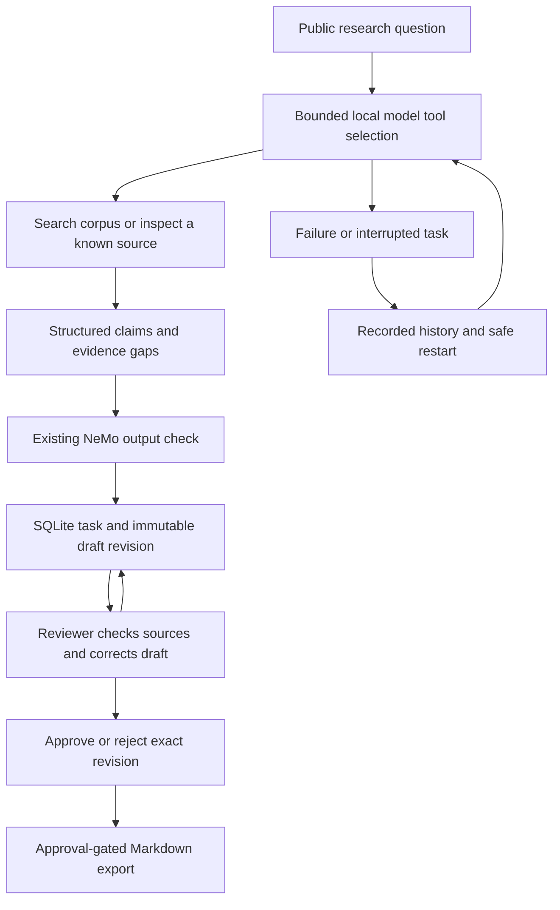

# Shipping an inspectable analyst workflow

## Problem and intended user

A research analyst needs a short Thailand/ASEAN brief that can be checked against
public evidence. A generated answer alone leaves the analyst without a reliable
way to correct omissions, record a decision or recover an interrupted task.

This project adds that complete interaction to AMI's existing retrieval and
generation work. It is personal portfolio engineering. External reviewer usage,
business usefulness and production operation have not been established.

## Implemented contribution

- Implemented an opt-in LangGraph workflow with two read-only tools and at most
  two tool rounds. Model-selected queries can differ from the original question;
  the comparison records the resulting coverage limits.
- Added a localhost browser workspace for source inspection, claim editing,
  explicit review, measurements and revision-specific export.
- Used SQLite transactions and unique keys for duplicate submissions, stale
  review rejection, immutable revisions and repeatable exports.
- Added local request protections and fail-closed output handling. These are
  scoped controls for a supervised public-data pilot.
- Repaired dependency resolution and separated standalone Spark from Databricks
  Connect. Fixed a live Ragas client/event-loop lifecycle failure discovered
  during the comparison and added regression coverage.
- Preserved the original agent entry points and evaluation artifact formats.
  The Databricks adapters and Medallion jobs remain available.

## Engineering decisions and observed limits

The RTX 4060 runs the 4k-context 8B generation model; the repeated judge uses the
8k alias. Local inference avoids hosted-model fees for this pilot, while energy,
hardware cost and NeMo internal token usage remain unmeasured.

Citation identifiers must resolve to retrieved records. This proves traceability,
not that the source entails the claim. Approval requires an explicit support
confirmation. Correcting a draft revokes its previous approval.

The five-case generation comparison returned nonempty answers for 5/5 legacy
attempts and claim-bearing drafts for 2/5 workflow attempts. The workflow's
abstentions and unsupported gap explanations are evidence of a quality problem,
not a demonstrated reliability improvement. See the dated validation report for
repeated judge results, source checks, failures and exact denominators.

Restart recovery marks incomplete tasks interrupted and restarts read-only work.
It does not resume inside a node. SQLite and a single worker keep this pilot
small and inspectable; multi-user authorization, durable distributed execution,
hard cancellation and production operations remain separate work.

## Evidence package

- [Workflow, setup and walkthrough](workflow.md)
- [Dependency changes and reproduction](dependencies.md)
- [Dated validation and evaluation](validation-2026-10-21.md)
- [Reviewer protocol and unsent invitation](reviewer-protocol.md)
- [Automated browser QA screenshot](browser-qa-overview.png)
- [Example exported brief, labelled automated QA](evidence/automated-qa-brief.md)
- [Generated answers and per-pass scores](evidence/results.json)

The browser QA exercised correction, approval invalidation, approval and export
using an explicitly automated QA alias. Task times and usefulness were left
blank. It is not an external reviewer session.

## Application wording supported today

> Built a local analyst-review workflow around AMI's Python/LangGraph retrieval
> pipeline, adding bounded read-only tools, source-linked claims, SQLite recovery
> and revision-specific approval/export. Reproduced dependency failures, added
> offline contract tests, and retained a five-case comparison that exposed
> coverage and completeness limits. External reviewer feedback is pending.

Use the dated report's actual test count and metric denominators when discussing
results. Do not claim production tenure, fintech employment, ROI or enterprise
readiness from this portfolio pilot.

## Next evidence gate

The owner should adjudicate the five paired outputs, invite 1–3 reviewers,
observe two tasks per person using the protocol, and choose one improvement from
their feedback. Record raw observations and rerun affected checks. MCP,
GraphRAG and additional infrastructure remain on the later roadmap until a
measured workflow failure justifies them.
