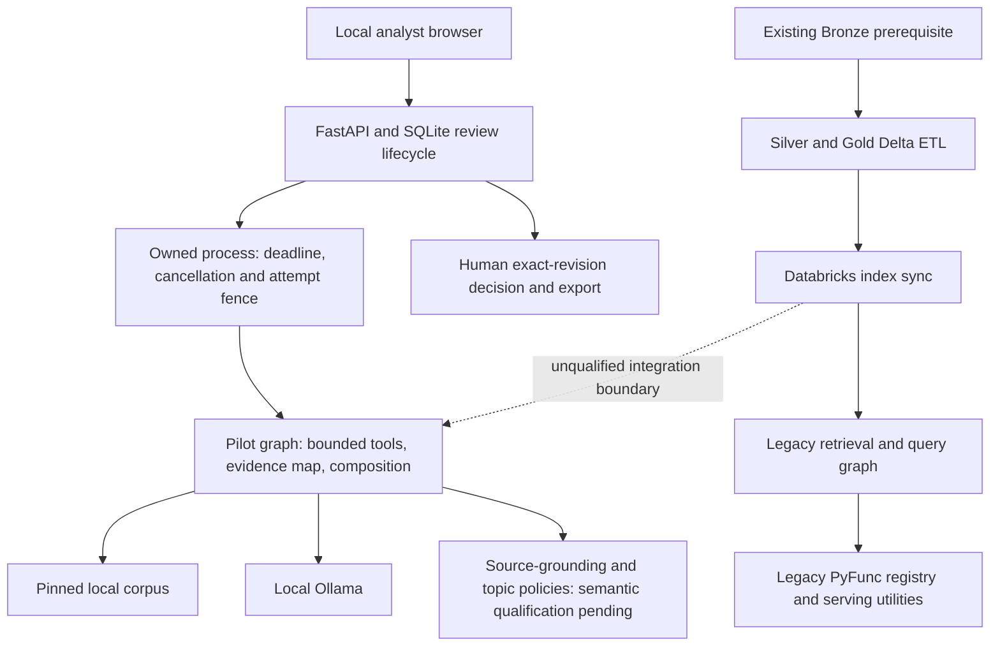

# Current architecture and serving boundary

## Implementation inventory

| Component | Current path | Evidence boundary |
|---|---|---|
| Legacy query runtime | `src/agents/graph.py` | Retrieval → structured analysis → NeMo wrapper; existing query API retained |
| Reviewed analyst runtime | `src/pilot/engine.py` | Separate opt-in graph with bounded tools, span mapping and composition; local Ollama only |
| Reviewer application | `src/pilot/api.py`, `index.html`, `schemas.py`, `store.py`, `_identity.py` | SQLite exact-revision human approval/export. Shared local bootstrap by default; optional per-principal tokens/roles with bound review identity; target deployment identity remains unqualified |
| Process control | `src/pilot/_runtime.py`, `_worker.py` | One owned process, two waiting slots, deadline/cancellation, owner-death watchdog, attempt fence and single-instance lease; offline fault tests are not a sustained live workload |
| Local retrieval | `local_retriever.py`, pilot `_passages`, `_choices`, `_scope`, `_retrieval_policy` | Raw lower-level BM25 preserved; analyst intent-fused lexical ranking or existing corpus-pinned profile; exact spans and narrow contrast/list checks, no general quality guarantee |
| Source-grounding policy | `src/utils/guardrails_runner.py`, `_periods.py`, `config/guardrails` | Activation repaired; model-only 5/6 diagnostic failed a critical date case. Explicit-period backstop and real workflow checks exist; incomplete generated answers still passed the policy |
| Source preparation | `scripts/prepare_market_sources.py`, `_source_text.py` | Pinned public snapshots and chunk manifests; not a live-news ingestion service |
| Delta ETL | `src/etl/silver_ingestion.py` | Existing Bronze prerequisite → Silver/Gold full refreshes; live recovery unqualified |
| Databricks retrieval/index | `src/agents/retriever_node.py`, `src/indexers/vector_search_sync.py` | Legacy Databricks adapters exist; reviewed pilot currently uses local Corpus |
| Evaluation | `src/evals`, `src/pilot/evaluate.py` | Frozen outputs, Ragas/MLflow and offline tests; historical results remain bounded |
| Registered model | `src/models/register_model.py` | PyFunc loads **legacy** `src.agents.graph.app`; unchanged constraints embedded and artifact relocation tested locally; target serving remains unqualified |
| Deployment utilities | `databricks.yml`, `src/models/deploy_endpoint.py` | Configurable jobs/model endpoint utilities; current target live behavior not verified |
| Packaging | Existing Docker/Compose plus `Dockerfile.pilot`, `compose.pilot.yml` | Actual non-root analyst build, Linux offline suite and container recovery/export checks pass. Host model metadata reachable; real container inference and external deployment pending |

## Staging boundary decision

Prepare the analyst application as the user-facing system of record. Its task/revision/review/export lifecycle must remain in durable application storage. A Model Serving inference request is not a durable human-review session. Do not put writable SQLite state inside an ephemeral model-serving replica or treat the legacy registered model as the reviewed pilot.

Before live staging, propose and authorize a versioned inference/retrieval adapter and hosting/model route that preserve public contracts. Keep the existing legacy model/API available. If registering analyst inference separately, verify its exact code, model/prompt/corpus settings, signature, output contract and caller before deploying. The local pilot currently rejects hosted providers; using a cloud model or exposing local Ollama requires an explicit design/budget/access decision. `localhost` in Databricks would not reach the owner's desktop.

The accepted target is existing Databricks staging after the local release. No new cloud resources, external deployment or model-provider migration is implied by this document. Neither Gold-table consumption nor upstream live-news automation should be claimed unless implemented and exercised.
